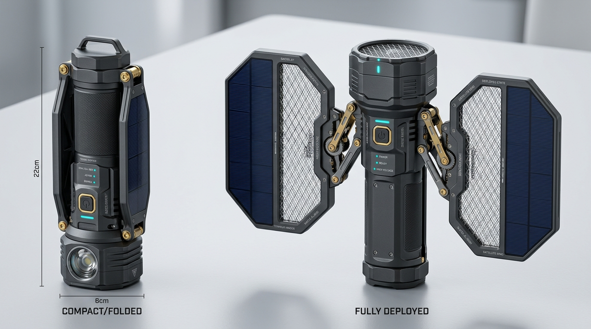

# AEGIS-ORBIT（轨道卫士）· 卫星太阳翼便携折叠电蚊拍
## 工业设计与工程规格白皮书（Edmonton 户外特化型）



---

## 1. 项目背景与设计使命

加拿大埃德蒙顿（Edmonton）拥有北美最长的城市公园带——北萨斯喀彻温河谷（North Saskatchewan River Valley）。每年夏秋季节，雪融积水与河漫滩草丛孕育了极其凶猛的北方林区蚊潮（主要物种为 *Aedes vexans* 刺扰伊蚊与 *Aedes communis* 雪原伊蚊）。这些蚊虫**体型大、抗风能力强、集群稠密**，传统普通家居电蚊拍由于**体积巨大无法随身收纳**，而常规便携小拍面往往**挥击面积过小、挥动阻力大、挥击半径短**，在徒步、露营和庭院活动中难以奏效。

**AEGIS-ORBIT（轨道卫士）** 汲取深空探测器与空间站刚性太阳能翼（Deployable Solar Arrays）的折叠展开灵感，将大面积高压电网精巧折叠进一根仅 **22cm** 长的战术手电筒筒体内，兼具**极小收纳体积**与**展开后宽大击杀翼展**，并集成露营诱蚊、强光战术照明与应急充电宝功能。

---

## 2. 核心架构与设计决策矩阵

经过多轮工程推演与设计树筛选，整机确立了以下核心架构参数：

| 系统模块 | 设计决策 | 工程原理与用户收益 |
| :--- | :--- | :--- |
| **展开机构** | **双侧四连杆刚性三折翼** | 仿卫星太阳能翼，滑动推块联动两翼 100% 同步展开，展开后双铰链死点自锁，抗暴力挥拍风阻晃动 |
| **收纳形态** | **整流罩一体自闭合八棱筒** | 折叠后两翼完全内嵌扣手机身侧槽，整机浑然一体，无外露棱角与网孔，放背包侧袋绝不钩挂衣物 |
| **挥击半径** | **模块化 1/4" 螺口拓展** | 平时 22cm 单手超短灵活挥打；底部自带 1/4" 标准螺口，可快速旋接碳纤维延长节或直接装在**户外登山杖**顶端 |
| **电气安全** | **机械触点导通 + 物理互锁** | 铰链轴内**绝不走高压软线**（消除金属疲劳拉弧）；完全展开自锁瞬间镀金触点闭合；折叠状态下物理绝对断电 |
| **操控交互** | **长条握力传感 + 寻蚊前灯** | 三挡旋转拨环（锁闭/击打/诱蚊）；击打挡握紧手柄自然通电（松手 0.1s 残电泄放）；拍根集成 45° 广角寻蚊灯 |
| **功能定位** | **3合1 户外生存电蚊工具** | 内置 21700 动力锂电（5000mAh），支持 20W PD 双向充手机；尾端 800lm 强光手电；立式/挂式 395nm 营地诱蚊灯塔 |
| **CMF 与防护** | **深空探测硬核科幻风 (IPX5)** | 航空级 6061-T6 铝合金阳极氧化机身 + 强化 PC 外壳 + 钛金 PVD 铰链连杆；不怕河谷露水与小雨 |

---

## 3. 机械展开机构与连杆运动学（Deployable Solar Array Kinematics）

```
【收拢状态 (Folded - 22cm)】
   [ 顶盖/寻蚊灯 ]
    |===|===|  <- 左右两翼紧密贴合扣在手柄凹槽内（整流罩包覆）
    | 机身  |  <- 内置 21700 电池与高压升压仓
    |===|===|
   [尾部手电筒] (直径 58mm，如战术手电)

        ↓↓↓ [推动手柄主滑块，四连杆机构联动向两侧撑开] ↓↓↓

【满展状态 (Fully Deployed - 翼展 38cm)】
     [左太阳翼网面]           [中心拍面]           [右太阳翼网面]
   +----------------+      +------------+      +----------------+
   | [太阳能饰纹板] |<====>|   机身中轴  |<====>| [太阳能饰纹板] |
   |  3500V 电网区  | 钛金连杆|  LED 状态灯 | 钛金连杆|  3500V 电网区  |
   +----------------+      +------------+      +----------------+
          \\                     ||                     //
           \=========[ 双侧死点机械卡爪自锁闭合 ]=========/
                                 ||
                          [战术手柄握把]
                                 ||
                          [底部 1/4" 螺口]
```

### 3.1 机构特征
1. **同步推杆与齿轮齿条联动**：主手柄正面设有一个带防滑纹的推拉滑块。单手大拇指向上平推滑块时，内部推杆驱动对称的小模数粉末冶金齿轮组，使左右两片拍翼以完全相同的角速度平稳向外展开。
2. **死点超行程自锁（Over-Center Hinge Lock）**：当两翼完全旋转展开至 180° 平面时，连杆越过机械死点，内置弹簧滑销“咔哒”一声卡入锁定槽内，拍面形成坚不可摧的刚性平面。即使以 8m/s 的极限挥速撕破空气，拍面也不会产生震颤或回折。
3. **一键按压解脱释放钮**：收拢时只需轻按手柄背面的解脱按钮，自锁卡销弹开，向下滑动手柄滑块，两翼顺滑地向内翻转收拢，严丝合缝地扣入机身侧壁凹槽。

---

## 4. 高压电气架构与硬核物理安全互锁

折叠类高压电器在工业界最大的安全难题在于：**频繁旋转的铰链会导致电线反复扭折疲劳断裂，甚至在机身内部产生 3000V 以上的拉弧击穿起火**。AEGIS-ORBIT 从根本上杜绝了这一隐患：

```mermaid
flowchart LR
    Batt[21700 动力锂电池 5000mAh] --> BMS[电池保护板 & 20W PD双向充放]
    BMS --> DialSwitch{机械旋转三挡拨环}
    
    DialSwitch -- "OFF / 锁闭" --> Locked[整机断电休眠]
    DialSwitch -- "TORCH / 手电" --> LED[底部 800lm CREE 战术手电]
    
    DialSwitch -- "BATTLE / 击打" --> LimitSwitch{机械展开自锁行程开关}
    LimitSwitch -- "未完全展开 / 折叠" --> CutOff[硬件级物理硬切断 - 0V]
    LimitSwitch -- "100% 满展自锁" --> PogoPin[端头镀金弹性触点接通]
    
    PogoPin --> GripSensor{手柄战术握力条}
    GripSensor -- "握紧" --> Inverter[高频升压变换器 (3500V脉冲)]
    Inverter --> Grid[3层三明治电击网 + 寻蚊射灯]
    GripSensor -- "松手" --> Bleeder[0.1秒 快速泄放电阻回路 (瞬间归零)]
```

### 4.1 物理弹性触点导电系统（Pogo-Pin Terminal）
* 两翼与中央骨架之间**没有任何外露或穿轴的柔性高压线缆**。
* 在每侧展开翼的末端和主骨架配合面上，分别镶嵌一组**厚金（30μ\" Gold Plated）大行程强力弹簧触针与端面电极**。
* 只有当翼面旋转到 179°~180° 并彻底完成机械自锁时，触点才被机械压合形成通路。折叠哪怕 2°，电极即物理脱离接触，绝无任何通电可能。

### 4.2 三层三明治安全防护网格
* **外层（双面保护网）**：零电位接地镀镍不锈钢菱形网，网眼间距 3.5mm。手指无论正面还是背面抚摸均完全无触电感。
* **内层（高压电击网）**：高纯度铝合金细密电极网，瞬时电压 3500V，对蚊蝇等小体型害虫释放高能量微脉冲，瞬间击穿外骨骼，绝不黏连焦糊。
* **快速残电泄放技术**：松开手柄握力条瞬间，内部并联的氧化铍高压放电电阻组在 **0.1 秒内**将储能电容的高压残荷吸收泄放至安全电压（< 36V），彻底告别传统电蚊拍关机后仍存留数秒静电电人的顾虑。

---

## 5. 多模式人机交互与户外生存系统

### 5.1 战术握把“即握即通”（Squeeze-to-Fire）
在 Edmonton 蚊虫扑面的野外，手持电蚊拍去盲摸小按键极易错失战机。
* AEGIS-ORBIT 手柄两侧镶嵌了人体工学导电硅胶握力微动开关条。
* 只要右手或左手自然握紧手柄，食指、中指和掌心压下侧条，电网瞬间注入 3500V 充沛能量；挥击击中后手掌自然略微放松，电网立即泄电断能。

### 5.2 拍头 45° 广角寻蚊灯
* 拍面根部嵌入 1 颗 OSRAM 5000K 高显色暖白广角微型 LED，光线刚好沿着拍面平面以 45° 扇面向前照亮。
* 在北纬 53° Edmonton 漫长的夏日黄昏微光与夜晚林间，蚊虫在逆光下呈现明显的高亮光点，瞄准挥拍命中率提升 300%。

### 5.3 露营“静置诱蚊灯塔”模式（395nm UV Trap）
* 展开两翼后，通过底部的 1/4" 螺孔将拍子旋接在迷你八爪鱼三角架上，放置于露营折叠桌或帐篷外门侧。
* 旋转挡位至 **TRAP**，左右两翼边缘的 6 颗 395nm 仿生诱蚊紫光 LED 点亮，高压网自动切换为持续 2200V 低功耗诱杀状态。依靠 21700 大容量电池，可不插电连续静置工作 **8~10 小时**，安睡整夜。

### 5.4 应急照明与移动电源（20W PD）
* **折叠态即为战术手电**：两翼收回后，手电筒透镜直接朝前。CREE XP-L 芯片提供 800 流明远射光束（照射距离达 150 米），具备强光、弱光、SOS 爆闪三种模式。
* **反向充手机**：户外徒步时如手机低温掉电，手柄底部的双向防水 USB-C 接口可输出 9V/2.22A (20W PD)，随时为 iPhone / Android 手机补充 70%~100% 电量。

---

## 6. Edmonton 户外模块化生态：登山杖快速接入系统

针对 Edmonton 居民热衷在 **River Valley Trail** 徒步、在 **Elk Island** 看野牛、在 **Jasper/Banff** 荒野徒步的特点，产品开发了专属的模块化连接体系：

```
       [ 展开的 AEGIS-ORBIT 拍头 ]
                   ||
         [ 1/4"-20 UNC 航空螺母 ]
                   ||
    =================================  <- 模块快接点
     [ 方案 A: 附带轻量碳纤维延伸管 ] 或 [ 方案 B: 兼容户外通用登山杖 ]
    =================================
                   ||
      [ 挥击半径扩展至 1.2m ~ 1.5m ]
                   ||
   【可轻松横扫过顶蚊虫、清空行进前方灌木丛】
```

* **高空与灌木扫荡**：河谷步道两旁的灌木丛中往往潜伏着密密麻麻的蚊群。接上登山杖后，挥击半径从 40cm 陡增至 1.2~1.5 米，徒步时可以像先锋开路一般在身前扫出一片“无蚊区”。
* **标准工业螺口兼容性**：底部螺孔为全球通用的 1/4"-20 UNC 规格，完美直连任何摄影三脚架、自行车车把支架或背包快拆挂扣。

---

## 7. CMF（色彩、材质、工艺）与硬件规格清单

### 7.1 CMF 设计规格
* **主骨架 & 手柄中筒**：6061-T6 航空级铝合金，经 CNC 精密五轴切削与喷砂阳极氧化处理，呈现深邃哑光深空灰（Space Grey）与深钛色。
* **铰链连杆与机械触销**：高强度 SUS301 不锈钢配 PVD 镀钛金（Titanium Gold），既耐磨抗疲劳，又呈现出空间站太阳能翼金色机械机构的硬核精密美感。
* **外保护壳**：德国拜耳（Covestro）阻燃加纤 PC 聚碳酸酯，具有超高抗冲击韧性与耐寒性（可耐受加拿大 -20°C 严寒不脆化）。
* **网面电极**：高导电铝镁合金内网 + 镀黑铬外层防锈安全网，低风阻编织工艺。

### 7.2 技术参数一览表

| 参数项 | 技术规格 |
| :--- | :--- |
| **收纳尺寸** | 长 220 mm × 宽 58 mm × 厚 48 mm（圆角八棱柱） |
| **满展尺寸** | 展开翼展 380 mm × 高 220 mm |
| **整机重量** | 385 克（含 21700 电池，重心分布于虎口手柄处） |
| **核心电芯** | 顶级 21700 动力锂离子电芯（容量 5000 mAh / 18.5 Wh） |
| **高压放电** | 主动击打模式 3500V 脉冲 / 静置诱蚊模式 2200V 恒压 |
| **残电泄放时间**| ≤ 0.1 秒（硬件级自动快速泄荷回路） |
| **战术手电光通量**| 800 流明（远射 150 米 / 3 档调光 + 爆闪） |
| **诱蚊光源** | 6 颗 395nm 仿生纳米级紫外波段 LED |
| **充电与输出** | 双向 Type-C PD 快充（输入 5V/3A 9V/2A；输出 20W PD） |
| **满电续航** | 纯挥打约 30~45 天 / 纯手电约 6 小时 / 静置诱蚊约 10 小时 |
| **防护等级** | **IPX5 防水抗水溅**（不怕露水雨淋）+ 1.5 米抗跌落 |
| **拓展接口** | 底部标准 1/4"-20 UNC 铜质螺孔 + 战术挂绳孔 |

---

## 8. 交互仿真原型体验

我们已为该方案构建了可交互的数字仿真原型。你可以在仿真器中自由滑动“展开滑块”，观察左右太阳翼连杆的展开自锁与物理断电互锁逻辑，切换 3 合 1 工作模式，并预览接上登山杖后的超长挥击状态。
可在界面中体验：
[打开交互仿真原型](file:///C:/Users/china/.gemini/antigravity/brain/1c2995d5-705d-4c7b-91a7-44f91816e055/swatter_interactive_widget.html)
