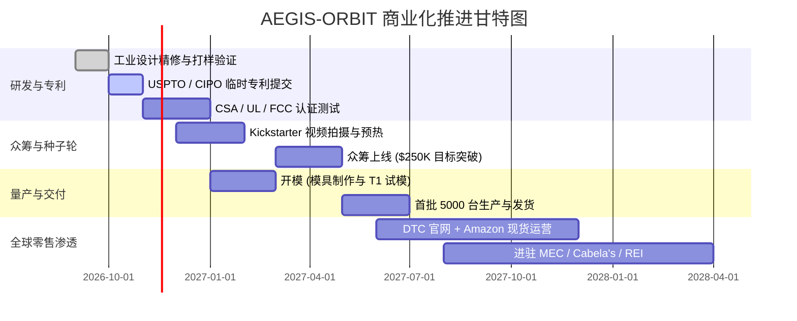
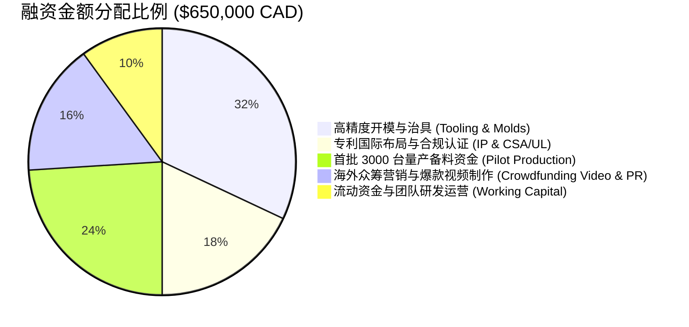

# AEGIS-ORBIT（轨道卫士）· 商业计划与投资融资方案书
## 仿生航天机构户外防虫装备与个人生态防御平台

**公司名称（拟设立）**：Aegis Outdoor Technologies Inc. (加拿大阿尔伯塔省埃德蒙顿)  
**项目代号**：Project Aegis-Orbit  
**文档版本**：Confidential - For Investors & Patent Attorneys Only (v1.0)  

---

## 1. 执行摘要与痛点契机 (Executive Summary & Market Opportunity)

### 1.1 埃德蒙顿及北美户外蚊潮危机
加拿大埃德蒙顿被誉为“北美河谷之都”，夏季日照长达 17 小时，北萨斯喀彻温河谷与周边湖泊湿地是徒步、露营、皮划艇与露台聚会的核心圣地。然而，每年 6 月至 9 月，以刺扰伊蚊（*Aedes vexans*）和雪原伊蚊为代表的吸血昆虫大规模爆发。这些蚊虫体型大、穿透力强、逆风飞翔迅猛，对户外活动造成毁灭性干扰。

### 1.2 现有产品致命缺陷（市场空白）
1. **传统家居电蚊拍（$10~$20）**：球拍状巨大体积，**完全不可折叠**，无法塞入登山包或口袋；塑料脆弱，户外一摔就碎；室内低电量铅酸/小锂电，无防水，无长距打击能力。
2. **化学驱蚊液（DEET / Picaridin）**：有刺鼻气味、黏腻感，对儿童和宠物有刺激性，且在河谷穿堂风下**几乎瞬间失效**。
3. **便携式加热驱蚊器（Thermacell 等）**：严重依赖昂贵的驱蚊片与丁烷气罐耗材，有风环境下保护罩失效，无法应对扑面而来的高速飞行蚊。

### 1.3 我们的解决方案：AEGIS-ORBIT
将**空间站刚性太阳翼折叠连杆机构**与**高能物理灭蚊电网**结合，开创**“高端硬核户外 EDC 防虫装备”**新品类：
* **极致收纳**：折叠后仅 **22cm** 战术手电筒体积（无外露网面，绝不钩破衣物）。
* **瞬间变身**：单手推开滑块，四连杆机构 0.5 秒展开 **38cm** 宽大卫星太阳翼，死点自锁，挥击刚性极强。
* **物理绝不断电**：首创铰链无导线弹性触点导电系统与物理安全互锁，攻克折叠电网行业痛点。
* **户外 3合1 生存拓展**：集成 **5000mAh 21700 电池（20W PD 反向充手机）+ 800lm 战术手电 + 营地静置紫外诱蚊灯塔 + 登山杖 1/4" 螺孔快接**。

---

## 2. 知识产权与专利交底书核心权利要求 (Patent Portfolio & Claims Strategy)

为构筑强大的技术壁垒并保护融资投资者利益，公司将在启动 Kickstarter 众筹公开前，通过美国专利商标局（USPTO）及加拿大知识产权局（CIPO）提交**临时专利申请（Provisional Patent Application）**，并于 12 个月内启动 **PCT 国际专利申请**。

### 2.1 核心发明专利 1（Utility Patent）
**发明名称**：可折叠网面灭虫装置及其无软线机械触点导电与物理断电互锁系统  
*(Deployable Multi-Panel Pest Elimination Apparatus with Cordless Contact Continuity and Physical Interlock Mechanism)*

#### 【独立权利要求 1 (Independent Claim 1)】
一种可折叠网面害虫灭杀装置，其特征在于，包括：
1. **中轴承载基座**，其内部收容有低压直流储能单元与高压脉冲发生电路；
2. **至少一对可展开拍翼**，分别枢接于所述中轴承载基座的两侧，且每一拍翼均包含外层绝缘安全防护网与内层高压释放电网；
3. **展开联动机构**，连接所述中轴承载基座与所述拍翼，可驱动拍翼在闭合收拢状态与平面满展状态之间往复运动；
4. **无软线机械导电终端系统**，在所述拍翼与所述中轴承载基座之间**不设置穿越旋转铰链的高压柔性导线**，而是在拍翼根部与基座配合面设置成对的弹性导电柱销与承接电极；仅当所述拍翼完全展开至预定终点死点角度时，所述弹性导电柱销与承接电极在机械压力下贴合导通高压回路；
5. **物理断电安全行程互锁**，所述基座内部设有微动安全开关，与所述联动机构机械耦合；当所述拍翼处于非完全展开的任一中间角度或闭合状态时，所述微动安全开关被物理顶脱断开，彻底切断所述高压脉冲发生电路的供电电源。

#### 【从属权利要求 (Dependent Claims)】
* **权利要求 2**：如权利要求 1 所述的装置，其特征在于，所述展开联动机构采用双四连杆超行程自锁机构（Over-center Linkage），展开终点位置具有弹性预紧自锁力，抵抗气动阻力晃动。
* **权利要求 3**：如权利要求 1 所述的装置，其特征在于，所述高压脉冲发生电路输出端并联有有源快速残电泄放网络，当用户解除激发动作后，电网残余电荷在 0.1 秒内泄放至安全电压阈值（≤ 36V）。
* **权利要求 4**：如权利要求 1 所述的装置，其特征在于，所述基座手柄表面纵向布置有触觉握力感应条，握持状态下通过掌心肌肉自然挤压力闭合激发回路，松手即刻断开。

### 2.2 实用新型与功能集成专利 2
**发明名称**：具备徒步杖快接与重心反向配平的模块化高位灭虫系统  
*(Modular Elevated Pest Defense System with Trekking Pole Coupling and Counterbalance Architecture)*

* **保护点**：将高密度的 21700 圆柱形动力电芯布置在手柄靠近手心与腕部的低位轴心，使得拍头网面在大幅度甩动时呈现极低的转动惯量；手柄尾部设置标准 1/4"-20 UNC 接口，直接将登山杖作为加长挥击力臂，实现 1.2m~1.5m 树冠及灌木丛远距清扫。

### 2.3 外观设计专利矩阵 (Design Patents)
* **外观专利 A**：卫星太阳能帆板式展开状态的几何比例与钛金连杆外形（Design of Deployed Spacecraft Solar Array Aesthetic）。
* **外观专利 B**：整流罩全包覆八棱柱战术手电闭合收纳体（Flush Octagonal Capsule Form Factor）。

---

## 3. 产品矩阵、BOM 成本拆解与单元经济模型 (Unit Economics)

### 3.1 供应链 BOM 成本拆解（基于首批 5,000 台深圳/宁波成熟供应链）

| 零部件分类 | 材料与制造工艺 | 采购单价 (USD) | 折合 (CAD) | 占比 |
| :--- | :--- | :--- | :--- | :--- |
| **金属结构件** | 6061-T6 铝合金 CNC/冲压、深空灰喷砂阳极氧化 | $3.80 | $5.13 | 20.0% |
| **展开连杆铰链** | SUS301 高韧不锈钢冲压、PVD 钛金镀层、精密微轴 | $1.60 | $2.16 | 8.4% |
| **注塑外壳** | 德国拜耳加纤防火 PC（双色注塑、耐寒抗冲） | $1.50 | $2.03 | 7.9% |
| **高压电网总成** | 3层镀镍外网 + 冲孔高纯铝内网 + 镀金 PogoPin 触点组 | $1.80 | $2.43 | 9.5% |
| **动力电芯** | 21700 动力锂电池 (5000mAh，EVE/亿纬锂能或 LG 级) | $3.20 | $4.32 | 16.8% |
| **PCBA 电子板** | 3500V 逆变倍压板 + 20W PD 双向充放 BMS + 握力传感板 | $2.80 | $3.78 | 14.7% |
| **光学与光源** | CREE 800lm LED + TIR 全反射透镜 + 6x 395nm UV 阵列 | $1.20 | $1.62 | 6.3% |
| **包装与配件** | 战术防震硬壳收纳盒、Type-C 编织线、1/4 转接扣 | $1.60 | $2.16 | 8.4% |
| **组装、测试、损耗** | IPX5 组装打胶、高压打火老化测试、跌落抽检 | $1.50 | $2.03 | 7.9% |
| **合计直接出厂成本 (COGS)** | **FOB 深圳完税单机成本** | **$19.00** | **$25.65** | **100%** |

### 3.2 零售定价策略与毛利率分析

| 销售渠道 / 阶段 | 终端零售价 (USD) | 终端零售价 (CAD) | 单台毛利 (USD) | 毛利率 (Gross Margin) |
| :--- | :--- | :--- | :--- | :--- |
| **Kickstarter 超早鸟价** | $49.00 | $66.00 | $30.00 | **61.2%** |
| **Kickstarter 正式众筹价** | $59.00 | $79.50 | $40.00 | **67.8%** |
| **DTC 官网 / 亚马逊 Prime** | $79.00 | $106.50 | $60.00 | **75.9%** |
| **线下户外零售渠道 (B2B)** | $42.00 (批发价) | $56.70 | $23.00 | **54.8%** (终端零售 $89) |

> **对标品牌毛利对比**：Olight（傲雷战术手电）毛利率 ~68%、BioLite 户外能源 ~65%、Thermacell 驱蚊器硬件 ~55%。AEGIS-ORBIT 凭借极高辨识度的机械创新外观，具备极强的高端溢价能力。

---

## 4. 市场进入策略与全球推广路线图 (Go-To-Market & Growth)

### 4.1 阶段一：Kickstarter / Indiegogo 众筹（2027 年 Q1 - Q2）
* **视觉爆发点**：一段拍摄于加拿大落基山脉（贾斯珀/班夫）及埃德蒙顿河谷的超高清 4K 宣传片——在黄昏林道中，随着“咔哒”一声机械脆响，像空间站般闪烁着幽蓝光芒的太阳翼从手电筒中展开，挥手间电弧火花爆鸣，精准清除蚊潮。
* **众筹目标**：筹集 **$250,000 USD**（约 4,000~5,000 名支持者），完成首批订单自循环与市场冷启动验证。

### 4.2 阶段二：DTC 与亚马逊全球站（2027 年 Q3 - Q4）
* 搭建 Shopify 品牌独立站，投放 Instagram / TikTok / YouTube 户外达人短视频。
* 开设 Amazon Canada 与 Amazon US 品牌旗舰店，入驻 FBA 仓实现次日达。

### 4.3 阶段三：北美高端户外连锁零售分销（2028 年）
* **加拿大本土**：进驻 MEC（Mountain Equipment Company）、Atmosphere、Cabela's Canada、Canadian Tire（Hunting & Fishing 专区）。
* **美国主流户外**：进驻 REI、Bass Pro Shops、Huckberry。

---

## 5. 三年财务预测模型 (3-Year Financial Forecast)

| 财务科目 (单位: USD) | 第一年 (2027) | 第二年 (2028) | 第三年 (2029) |
| :--- | :--- | :--- | :--- |
| **销量 (台)** | **18,000 台** | **65,000 台** | **180,000 台** |
| 平均销售客单价 (ASP) | $62.00 (众筹+DTC) | $68.00 (DTC+零售) | $70.00 (全球多渠道) |
| **总营收 (Revenue)** | **$1,116,000** | **$4,420,000** | **$12,600,000** |
| 销售成本 (COGS @ $19~$17) | $342,000 | $1,170,000 | $3,060,000 |
| **毛利润 (Gross Profit)** | **$774,000 (69.4%)** | **$3,250,000 (73.5%)** | **$9,540,000 (75.7%)** |
| 市场营销与获客费用 (CAC) | $280,000 | $950,000 | $2,600,000 |
| 模具开发与研发摊销 | $85,000 | $120,000 | $250,000 |
| 团队薪酬与运营费用 | $120,000 | $450,000 | $1,200,000 |
| 专利维护与合规认证 | $35,000 | $50,000 | $80,000 |
| **净利润 (Net Profit / EBITDA)**| **$254,000 (22.8%)** | **$1,680,000 (38.0%)** | **$5,410,000 (42.9%)** |

---

## 6. 本轮融资计划与资金用途 (Financing Round & Capital Allocation)

### 6.1 融资金额与估值
* **本轮融资轮次**：天使轮 / Pre-Seed 轮
* **拟融资金额**：**$650,000 CAD**（约 **$480,000 USD**）
* **出让股权比例**：**15% ~ 20%**（投前估值约 $2,600,000 ~ $3,500,000 CAD），支持通过 **SAFE (Simple Agreement for Future Equity)** 协议投资（设 $3.5M CAD 估值上限与 20% 折扣率）。

### 6.2 资金使用明细（Use of Funds）

1. **精密模具与夹具投入 (32% / $208,000 CAD)**：
   * 铝合金五轴挤型模具、双色防摔注塑模具、PVD 铰链连杆级进五金模。
2. **知识产权与国际安全认证 (18% / $117,000 CAD)**：
   * USPTO/CIPO 发明专利全套代理与加速审查、PCT 国际专利进入阶段费用。
   * 北美消费者安全认证：**CSA C22.2 No. 60335-2-59**（电灭虫器安全标准）、**UL 1559**、**FCC Part 15 / ICES-003**、**UN38.3 锂电池航空安全认证**。
3. **首批 3,000 台量产备料与供应链周转 (24% / $156,000 CAD)**：
   * 采购 21700 动力电芯、定制 Pogo-Pin 弹性触针组、高压升压变压器核心器件。
4. **众筹视频制作与海外数字营销 (16% / $104,000 CAD)**：
   * 聘请北美顶级众筹视觉制作团队（如 Jellop / LaunchBoom 合作推流），打造好莱坞科幻级产品片；向 30+ 北美头部露营、EDC、科技科技博主派发工程工程样机。
5. **运营流动储备资金 (10% / $65,000 CAD)**：
   * 埃德蒙顿团队运营、仓储与突发供应链应急储备。

---

## 7. 退出渠道与投资者回报 (Exit Strategies)

1. **产业巨头并购 (M&A) —— 预估第 3~4 年**：
   * **潜在买家 A（户外装备集团）**：Newell Brands（Coleman 帐篷品牌母公司）、Black Diamond、Johnson Outdoors。
   * **潜在买家 B（害虫控制与家居能源巨头）**：Spectrum Brands（Cutter / Repel 驱蚊巨头）、Thermacell Repellents Inc.。
   * **潜在买家 C（高端照明与战术 EDC 巨头）**：Olight（傲雷）、Nitecore（奈特科尔）。
   * **并购估值预期**：基于第 3 年 EBITDA ($5.4M USD) 的 6x~8x 估值乘数，预计并购价值达 **$3,200 万 ~ $4,300 万 USD**（为天使轮投资者提供 **10x ~ 15x** 现金回报）。
2. **高分红持续自造血 (Dividend Recapitalization)**：
   * 凭借 70%+ 的高毛利与轻资产代工制造架构，项目在第二年即实现规模化净现金流转正，可通过年度利润分红持续回馈股东。
