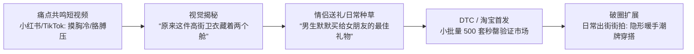

# AURA-HUG（云抱服）· 知识产权、供应链与商业落地全流程方案
## 从样衣打板到全网冷启动的实操白皮书

> **文档性质**：商业与专利实操指南 (Commercial & IP Roadmap)  
> **归属智库**：`idea-vault / ideas / 02-cuddle-loungewear`

---

## 1. 专利布局与法律保护壁垒 (IP & Patent Claims Strategy)

为了防止淘宝或亚马逊竞品在产品打爆后光速抄袭，必须在第一批样衣定型并启动公众营销前，完成中国国家知识产权局（CNIPA）以及海外临时专利（US Provisional Patent）的交底布局。

### 1.1 核心实用新型专利（Utility Model Patent）
**专利名称**：一种具备手臂分载减压与双舱私密隔温功能的智能家居服饰  
*(A Loungewear Garment with Ergonomic Arm-Load Redistribution and Dual-Chamber Thermal Isolation)*

#### 【核心独立权利要求 1 (Independent Claim 1)】
一种多功能家居服饰，其特征在于，包括：
1. **服饰主体**，覆盖穿戴者的躯干部位，且具备前片、后片以及侧缝拼接区；
2. **复合双舱袋组件**，对称布置于所述服饰主体的侧胸及侧肋部位，包含：
   * **蓄热外舱**：位于服饰外层，具有外侧隐形开口与封闭底部的保暖内衬腔体；
   * **内舱连通通道**：位于所述外舱的贴身侧壁，设有贯穿至穿戴者皮肤表面的柔性门襟开衩，且该开衩具备弹性自动回弹重叠结构，在未受外力引导状态下保持常闭密封；
3. **后向力学分载网**，内置于所述服饰主体的侧缝与后片夹层中，所述复合双舱袋的承重沿口与该分载网机械连接；当外部手臂重力垂直施加于所述双舱袋上部时，该分载网将垂直向下的压强转化为沿后背及下摆周向延伸的平面剪切拉力，实现向穿戴者背侧与接触床面的重力导流。

#### 【从属权利要求 (Dependent Claims)】
* **从属权利要求 2**：如权利要求 1 所述的服饰，其特征在于，所述内舱连通通道的门襟边缘埋设有厚度小于 0.5mm 的超薄无感柔性磁吸件或树脂自复位记忆骨。
* **从属权利要求 3**：如权利要求 1 所述的服饰，其特征在于，所述复合双舱袋底部复合有厚度为 1.5mm~3.0mm 的 3D 三维蜂窝空气间隔减压织物。
* **从属权利要求 4**：如权利要求 1 所述的服饰，其特征在于，所述服饰主体外层采用极简法式公主线立体拼接，将所述双舱袋的外侧开口完全隐藏于侧身结构装饰缝内。

---

## 2. 供应链落地与找厂打样实操手册 (Supply Chain & Sourcing)

服装产业是高度专业分工的轻工业，切忌在没有打样的情况下直接找量产大厂。建议分为三步推进：

### 阶段一：个人 MVP 与样衣工作室打板（1~2 周，预算约 ¥1,500 ~ ¥3,000）
* **寻找渠道**：
  * 在小红书或微信搜索“**广州独立服装制版打样工作室**”或“**杭州四季青样衣打板工作室**”。
  * 寻找擅长**“重磅卫衣 / 运动瑜伽服无缝压胶”**的版师（Pattern Maker）。
* **打板交付物**：
  * 提供一份 1:1 的纸样（CAD 样板）与 2~3 套真人试穿样衣。
  * **家庭睡眠盲测（Dogfooding）**：你自己和妻子必须穿着连续试睡 7 天。重点检验：侧躺时手臂搭上来的压感是否明显减轻？外出的隐形度是否能通过逛超市/散步检验？

### 阶段二：寻找量产工厂（OEM/ODM 阶段）
* **中国核心产业带**：
  * **广东东莞（虎门）**：全球中高端时尚卫衣、潮牌 Athleisure 与女装快反中心（擅长将功能性与潮牌高级感结合）。
  * **广东汕头（潮阳/谷饶）**：全球内衣与高档家居服制造之都（擅长贴身亲肤面料与无缝粘合压胶工艺）。
  * **浙江义乌/海宁**：功能性无缝针织基地。
* **1688 寻找与洽谈话术模板**：
  * 筛选标签：选择“**实力商家**”、“**超级工厂**”，支持“**加工定制 / 拿样**”。
  * 搜索词：`空气层卫衣裙 工贸一体` / `功能性无缝家居服 OEM`。
  * 提问范式：
    > *“我们是一家新锐生活方式品牌，有一款带有内层隐藏无缝压胶口袋的重磅空气层卫衣裙需要打样。首批测试单 100~300 套，后续月翻单 1000+。你们工厂能否做无缝点胶与双层叠片工艺？请发几个近期做过的类似结构样品。”*

---

## 3. BOM 成本模型与定价体系 (Unit Economics)

基于首批 **500 套小单快反** 测算（东莞/汕头工贸一体供应链）：

| 成本组成项 | 材料与工艺规格 | 单件成本 (RMB) | 折合单件 (USD) | 占比 |
| :--- | :--- | :--- | :--- | :--- |
| **面料原料** | 300g 精梳棉/莫代尔混纺空气层面料（约 1.8 米） | ¥28.00 | $3.90 | 41.2% |
| **辅料内衬** | 德绒发热内衬 + 3D 空气网布 + 医用 TPU 点胶带 | ¥8.50 | $1.18 | 12.5% |
| **裁剪与车缝** | 包含隐形公主缝打褶、双舱复杂口袋拼接车缝工时 | ¥18.00 | $2.50 | 26.5% |
| **后道整理包装** | 挂烫、线头质检、高克重磨砂哑光拉链袋、定制纸质吊牌 | ¥5.50 | $0.76 | 8.1% |
| **物流与税耗** | 单件出厂平摊运费与损耗 | ¥8.00 | $1.11 | 11.7% |
| **合计直接出厂成本 (COGS)** | **首批小单出厂成本（后续破万件可降至 ¥48）** | **¥68.00** | **$9.45** | **100%** |

### 零售与毛利策略
* **国内天猫/小红书/抖音零售价**：**¥299 ~ ¥399 元**（毛利率 **77% ~ 83%**）。
* **海外 DTC 独立站 / Kickstarter 零售价**：**$79 ~ $99 USD**（毛利率 **88%**）。
* **对标与定位**：避开普通 ¥50 的廉价南极人睡衣，直接切入与 **Skims、Bananain 蕉内、Lululemon Lounge** 同等心智的“高机能亲密生活方式装备”，产品天然具备高溢价说服力。

---

## 4. 营销与冷启动路线图 (Go-To-Market & Viral Loops)

该产品具有**自发裂变传播属性**。宣传的关键是**“体面、高级、直击情侣痛点”**，切忌打擦边球走下三路。

1. **核心场景短视频（病毒式吸睛）**：
   * *镜头 1（共鸣）*：冬天卧室关灯，老公手冻得像冰棍，往老婆被窝一钻，想撩衣服被老婆一脚踹开：“冷死了别掀我衣服！还有你胳膊压得我喘不过气！”
   * *镜头 2（反转与解决）*：换上 AURA-HUG，老公手自然滑进侧兜，在发热内舱暖了 30 秒，手指轻轻一顺无缝穿透入内摸胸，老婆毫无抗拒安然沉睡；老公胳膊沉沉压上，力学悬浮网分散重力，老婆呼吸平缓。
   * *镜头 3（白天惊艳出街）*：第二天早晨，老婆直接套着这件卫衣裙端着咖啡出门散步，双手插兜，时尚极简，路人完全看不出任何私密痕迹。
2. **种子用户社群冷启动**：
   * 在小红书寻找 20 位恋爱/夫妻生活方式类博主（KOC，粉丝量 1万~5万），寄送手工定制第一批打样，做真实试睡与穿搭测评。
